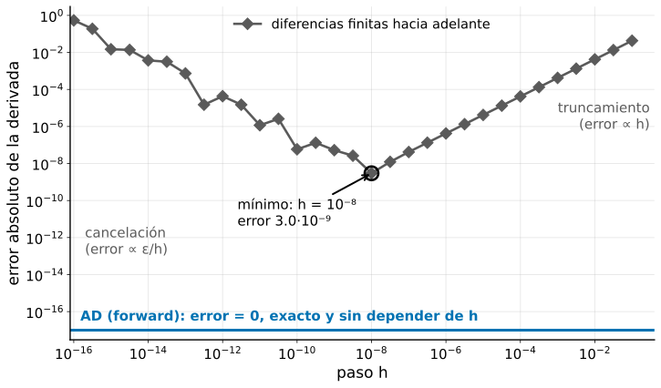
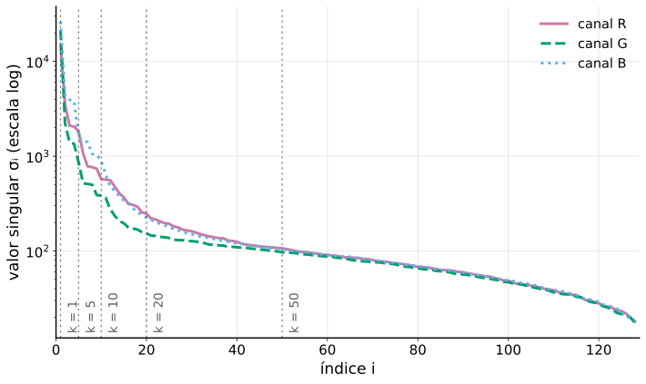
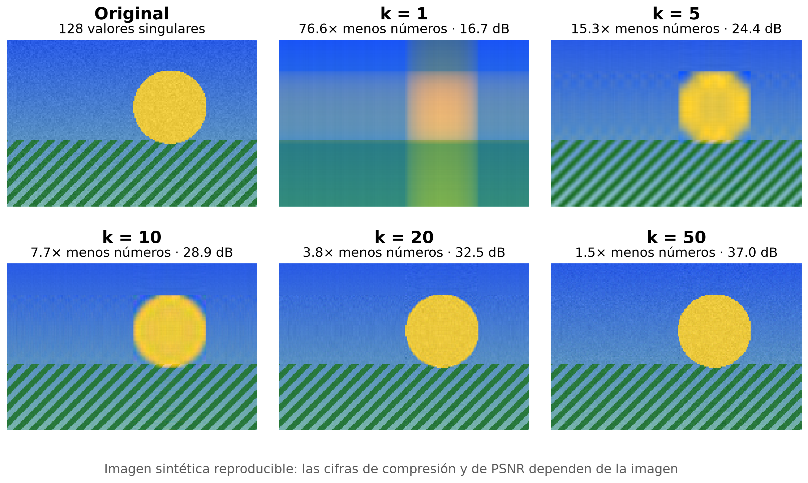
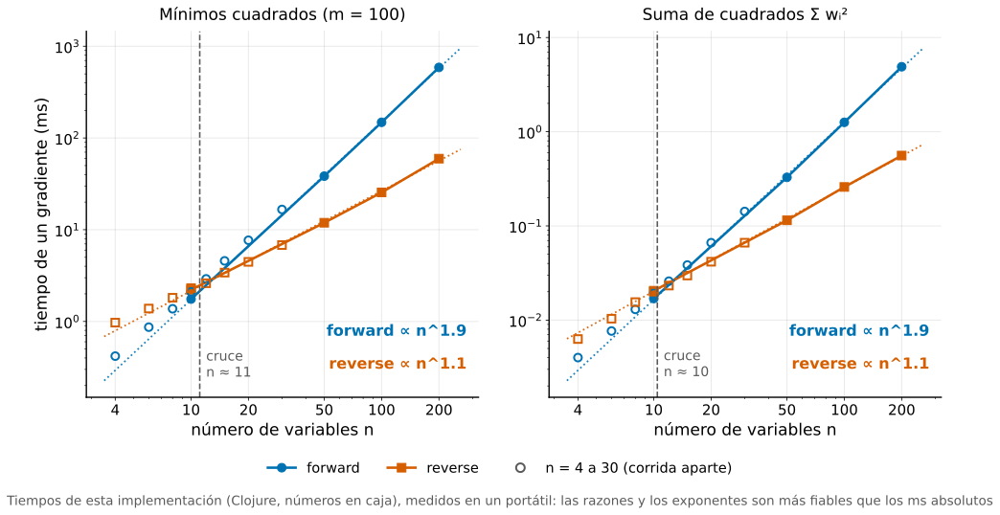
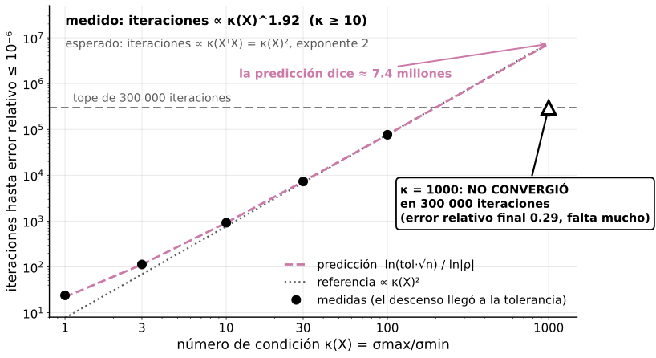
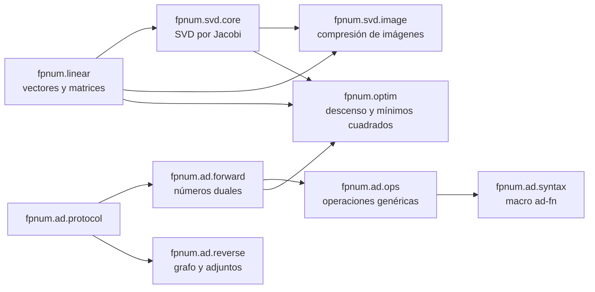

# fp_numerics

> Diferenciación automática (forward y reverse), SVD y mínimos cuadrados, implementados desde cero en Clojure.


<!-- Insignia del CI: descomentar cuando exista el repositorio y el workflow se haya ejecutado al menos una vez
     (hoy el workflow está configurado pero NO se ha ejecutado nunca). Usuario ya puesto:
 -->

Proyecto académico desarrollado en el semillero **Programación Funcional** de **Universidad Nacional de Colombia, Sede Bogotá**, **2026**. Explora varias ideas del álgebra lineal numérica con un enfoque funcional: datos inmutables, funciones puras y composición.

> **Dos avisos antes de leer los resultados.**
> 1. Las cifras de **compresión de imágenes** son de una **imagen sintética** reproducible (con bordes, textura y ruido), no de una fotografía: con otra imagen cambian. Se sustituirá por una imagen de licencia clara.
> 2. Los **tiempos** se dan como **razones y exponentes**, no en milisegundos. Se midieron en un portátil cuyo rendimiento varía entre corridas hasta 2.5 veces; las razones entre dos medidas tomadas intercaladas son lo fiable.

## Qué incluye

1. **Diferenciación automática (AD) en modo forward**, con números duales, y **en modo reverse**, con un grafo de cálculo y adjuntos. Las funciones se escriben una vez y sirven en los dos modos.
2. **SVD por Jacobi de un solo lado**, con dos implementaciones del mismo algoritmo: una inmutable y legible, y una rápida con arrays.
3. **Compresión de imágenes** con SVD de bajo rango, con una página interactiva.
4. **Descenso de gradiente** (con el gradiente por AD) y **mínimos cuadrados** por ecuaciones normales y por pseudoinversa.
5. **Unión de lo anterior:** cómo la velocidad del descenso depende del número de condición $\kappa(X)$, frente a la pseudoinversa por SVD.
6. **Mediciones** que comparan forward con reverse y la SVD rápida con la de referencia.

## Resultados

Cada cifra tiene su fuente (un CSV de `docs/data/` o una prueba) en [`docs/cifras.md`](docs/cifras.md). Los CSV se regeneran con los demos (ver [Cómo ejecutarlo](#cómo-ejecutarlo)).

### Diferenciación automática frente a diferencias finitas



*Figura 1. Error de la derivada de $\sin x$ en $x = 1$. Con diferencias finitas baja hasta un mínimo de 3.0·10⁻⁹ en $h = 10^{-8}$ y vuelve a subir a ambos lados (cancelación a la izquierda, truncamiento a la derecha); la diferenciación automática da la derivada exacta (error 0 en este ejemplo) sin depender de $h$.*

| Método | Error |
|---|---|
| Diferencias finitas hacia adelante, mejor $h$ ($10^{-8}$) | 3.0·10⁻⁹ |
| Diferenciación automática (forward) | 0 |

### Descenso de gradiente

| Experimento | Iteraciones | Resultado |
|---|---:|---|
| Mínimos cuadrados (100 observaciones, ruido $\sigma = 0.1$, semilla 42), paso seguro | 37 | a 3.0·10⁻¹¹ de la solución por ecuaciones normales |
| Rosenbrock desde $(-1.2,\ 1)$, con *backtracking* (Armijo) | 13 756 | $(0.9999992,\ 0.9999984)$ |

### SVD: precisión

Frente a los valores singulares de NumPy en 12 matrices (cuadradas, altas, anchas, de rango deficiente y de Hilbert):

- diferencia máxima de $\sigma$: **7.8·10⁻¹⁶·σ₁**;
- error relativo de reconstrucción $\le$ 1.7·10⁻¹⁵ y ortonormalidad de $U$ y $V$ $\le$ 5.3·10⁻¹⁵;
- entre 1 y 9 barridos de rotaciones.

**Por qué no se forma $A^\top A$.** Pasar por $A^\top A$ eleva al cuadrado el número de condición ($\kappa(A^\top A) = \kappa(A)^2$) y destruye los valores singulares pequeños. Error relativo del $\sigma$ mínimo:

| Matriz | $\kappa$ | Jacobi directo | Vía $A^\top A$ |
|---|---:|---:|---:|
| 3×3 | 3.7·10⁰ | 0 | 1.8·10⁻¹⁶ |
| aleatoria 10×10 | 9.9·10¹ | 7.5·10⁻¹⁶ | 1.6·10⁻¹³ |
| Hilbert 5 | 4.8·10⁵ | 7.8·10⁻¹² | 6.6·10⁻⁷ |
| decaimiento geométrico 12×12 | 1.0·10¹⁰ | 2.9·10⁻⁸ | **1.2·10²** |
| Hilbert 8 | 1.5·10¹⁰ | 1.3·10⁻⁷ | **1.3·10²** |
| Hilbert 10 | 1.6·10¹³ | 8.0·10⁻⁵ | **4.3·10⁵** |

Un error relativo de 10² o más significa que el valor es basura. Como referencia independiente de NumPy, el producto de los valores singulares coincide con el determinante exacto de Hilbert (calculado con racionales) con error relativo 4.5·10⁻¹², 1.0·10⁻⁷ y 2.5·10⁻⁵ para Hilbert 5, 8 y 10; ese error crece con $\kappa$ porque la matriz guardada en doubles ya difiere de la exacta.

### SVD: velocidad (implementación rápida frente a la de referencia)

Las dos hacen **los mismos barridos** (aquí, 10, 13 y 13) y dan **resultados idénticos bit a bit** en las matrices de prueba; la rápida usa arrays `double[]` encapsulados y mantiene en caché las normas de las columnas.

| $n$ | Razón de tiempos (referencia / rápida), una corrida |
|---:|---:|
| 64 | 15× |
| 128 | 66× |
| 256 | 112× |

En otras corridas la razón con $n = 256$ fue de unas 50 a 110 veces (ver [`docs/data/svd-benchmark-notas.md`](docs/data/svd-benchmark-notas.md)): se puede afirmar «dos órdenes de magnitud», no una cifra exacta.

### Compresión de imágenes con SVD

Cada canal (R, G, B) es una matriz $A$ de $128 \times 192$. Se conservan los $k$ valores singulares mayores: $A_k = \sum_{i=1}^{k} \sigma_i u_i v_i^\top$, la mejor aproximación de rango $k$ (Eckart–Young–Mirsky).



*Figura 2. Los valores singulares de la imagen sintética caen dos órdenes de magnitud en los primeros ~20 índices: unos pocos términos concentran casi toda la información. Con $k = 20$ se retiene el **99.82 %** de la energía (`svd-image-metrics.csv`).*



*Figura 3. Con $k = 5$ ya se reconoce la escena y con $k = 20$ casi no se distingue de la original, pero el ahorro se agota pronto: 15.3× menos números con $k = 5$, 3.8× con $k = 20$ y solo 1.5× con $k = 50$ (PSNR de 24.4, 32.5 y 37.0 dB). **Todas las cifras son de la imagen sintética**; con otra imagen cambian.*

| $k$ | Energía retenida | Error relativo | PSNR (dB) | Razón de compresión |
|---:|---:|---:|---:|---:|
| 1 | 92.98 % | 0.2650 | 16.7 | 76.56× |
| 2 | 95.46 % | 0.2130 | 18.6 | 38.28× |
| 3 | 96.95 % | 0.1746 | 20.3 | 25.52× |
| 5 | 98.81 % | 0.1091 | 24.4 | 15.31× |
| 8 | 99.37 % | 0.0791 | 27.2 | 9.57× |
| 10 | 99.58 % | 0.0647 | 28.9 | 7.66× |
| 15 | 99.76 % | 0.0493 | 31.3 | 5.10× |
| 20 | 99.82 % | 0.0426 | 32.5 | 3.83× |
| 30 | 99.88 % | 0.0351 | 34.2 | 2.55× |
| 40 | 99.91 % | 0.0297 | 35.7 | 1.91× |
| 50 | 99.94 % | 0.0253 | 37.0 | 1.53× |
| 75 | 99.97 % | 0.0160 | 41.0 | 1.02× |
| 100 | 99.99 % | 0.0082 | 46.6 | 0.77× |
| 128 | 100.00 % | 0.0000 | ∞ | 0.60× |

La razón de compresión es $mn / \big(k(m+n+1)\big)$: con $k$ grande es menor que 1 (almacenar la SVD ocupa más que la imagen). El PSNR se calcula sobre la imagen redondeada a 8 bits. La energía es la de la matriz sin centrar, por eso $k = 1$ ya retiene casi todo: captura el brillo medio. Una página interactiva con un deslizador de $k$ se genera con el demo de SVD (`docs/demo-svd/index.html`).

### Forward frente a reverse

Forward necesita una pasada por variable: un gradiente de $n$ variables cuesta $n$ evaluaciones de $f$. Reverse lo obtiene con una pasada hacia adelante y una hacia atrás, sin depender de $n$.



*Figura 4. El costo de un gradiente crece como $n^2$ con forward y como $n$ con reverse (exponentes medidos 1.9 y 1.1), así que reverse empieza a ganar a partir de unas 10–11 variables y con $n = 200$ es de 10 a 12 veces más rápido en mínimos cuadrados (de 9 a 11 en la suma de cuadrados); con muy pocas variables pierde. **Son medidas de esta implementación** (Clojure con números en caja) en un portátil: las razones y los exponentes son lo fiable, los tiempos absolutos no.*

Razón de tiempos forward / reverse (mediana de razones por rondas intercaladas; entre paréntesis, otra corrida independiente):

| $n$ | Mínimos cuadrados ($m = 100$) | Suma de cuadrados $\sum w_i^2$ |
|---:|---:|---:|
| 10 | 0.78 (0.91) | 0.81 (0.94) |
| 50 | 3.2 (3.9) | 2.9 (3.6) |
| 100 | 5.8 (7.1) | 4.8 (6.1) |
| 200 | 10.0 (12.3) | 8.8 (11.0) |

Una razón menor que 1 significa que reverse es más lento. Exponentes del ajuste log-log (dos corridas): forward 1.92–1.94 y reverse 1.05–1.09 en mínimos cuadrados; 1.89–1.92 y 1.10–1.11 en la suma de cuadrados. El punto en que la razón vale 1 es $n \approx 10$–$11$ (11.1 y 10.4 en las dos funciones).

### Mínimos cuadrados mal condicionados: pseudoinversa por SVD frente a descenso de gradiente

Se resuelve $\min \lVert Xw - y \rVert^2$ de dos formas: la pseudoinversa por SVD, $w = X^{+}y$ (directa), y el descenso de gradiente por AD con el paso seguro $\alpha = 0.9/\lVert X\rVert_F^2$. El error de la dirección singular más lenta se multiplica por $\rho = 1 - 2\alpha\sigma_{\min}^2 \approx 1 - 1.8/\kappa(X)^2$ en cada iteración.



*Figura 5. Las iteraciones del descenso de gradiente son proporcionales al número de condición de la Hessiana, $\kappa(X^\top X) = \kappa(X)^2$, por eso se espera un exponente 2 en $\kappa(X)$; el medido es **1.92** y las iteraciones coinciden con la predicción teórica. Con $\kappa(X) = 1000$ el descenso **no converge** en 300 000 iteraciones (la teoría pide unos 7.4 millones) y su error relativo final sigue en 0.29.*

| $\kappa(X)$ | Iteraciones predichas | Iteraciones medidas | Error real cuando $\lVert\nabla f\rVert \le 10^{-8}$ |
|---:|---:|---:|---:|
| 1 | 22 | 24 | 4.9·10⁻⁹ |
| 3 | 113 | 113 | 4.3·10⁻⁸ |
| 10 | 921 | 921 | 4.9·10⁻⁷ |
| 30 | 7 312 | 7 312 | 4.5·10⁻⁶ |
| 100 | 76 444 | 76 444 | 5.0·10⁻⁵ |
| 1000 | 7 363 834 | **no converge** (tope de 300 000) | — |

La última columna muestra que **parar cuando $\lVert\nabla f\rVert$ es pequeño engaña**: con $\kappa(X) = 100$, el error real es 50 veces mayor que la tolerancia de $10^{-6}$ que se buscaba, porque $\nabla f = 2X^\top X (w - w^\ast)$ vale solo $2\sigma_{\min}^2$ por el error en la dirección lenta.

La pseudoinversa, en cambio, **no depende de $\kappa$ para su costo** y su error es del orden de $\kappa\varepsilon$ (en estas mediciones, hasta unas 6 veces ese valor, y 24 veces con $\kappa = 10^{12}$), mientras que las ecuaciones normales lo elevan al orden de $\kappa^2\varepsilon$:

| $\kappa(X)$ | Error con SVD | Error con ecuaciones normales |
|---:|---:|---:|
| 1 | 7.6·10⁻¹⁶ | 2.9·10⁻¹⁶ |
| 10² | 4.2·10⁻¹⁴ | 3.0·10⁻¹⁴ |
| 10⁴ | 5.7·10⁻¹³ | 1.5·10⁻⁹ |
| 10⁶ | 8.3·10⁻¹¹ | 2.7·10⁻⁵ |
| 10⁷ | 1.5·10⁻⁹ | singular (`solve` la rechaza) |
| 10⁸ | 1.4·10⁻⁸ | singular |
| 10¹⁰ | 1.7·10⁻⁶ | singular |
| 10¹² | 5.3·10⁻³ | singular |

Con una columna duplicada (rango deficiente) las ecuaciones normales fallan, la SVD da la solución de **mínima norma**, y el descenso desde $w = 0$ converge a esa misma solución (en 81 iteraciones, a 2.8·10⁻¹⁴): el gradiente siempre está en el espacio fila de $X$, así que el descenso nunca se sale de él.

## Cómo ejecutarlo

**Requisitos:** un JDK, la [Clojure CLI](https://clojure.org/guides/install_clojure) y `git` (el *test-runner* es una dependencia git). **Verificado con JDK 25 en Windows 11**; no se ha verificado ninguna otra versión ni sistema. En Windows, la Clojure CLI se instala como módulo de PowerShell, y los comandos se ejecutan desde PowerShell.

```bash
git clone https://github.com/Juanangara/fp_numerics.git
cd fp_numerics

clojure -M:test                                   # pruebas (unitarias y de propiedades)
clojure -M:repl                                   # REPL interactivo
```

| Comando | Qué hace | Escribe en `docs/` | Duración aproximada |
|---|---|---|---|
| `clojure -M -m fpnum.demo.ad` | derivada por AD frente a diferencias finitas | `data/error-vs-h.csv` | segundos |
| `clojure -M -m fpnum.demo.descent` | descenso en mínimos cuadrados y Rosenbrock | `data/descent-*.csv` | segundos |
| `clojure -M -m fpnum.demo.svd [imagen]` | compresión con SVD (usa `docs/img/original.jpg`, o una imagen sintética si no existe) | `demo-svd/`, `data/svd-image-*.csv` | segundos |
| `clojure -M -m fpnum.demo.svd benchmark [n...]` | SVD de referencia frente a la rápida | `data/svd-benchmark-*.csv` | minutos con los tamaños por defecto |
| `clojure -M -m fpnum.demo.conditioning [κ...]` | SVD frente a descenso según $\kappa$ | `data/conditioning-*.csv` | de 1 a 3 minutos |
| `clojure -M -m fpnum.demo.reverse` | forward frente a reverse según $n$ | `data/ad-forward-vs-reverse.csv` | unos 30 segundos |
| `clojure -M -i scripts/generate_accuracy_csvs.clj` | precisión de la SVD frente a NumPy | `data/svd-accuracy.csv`, `data/svd-ata-vs-directo.csv`, `data/svd-hilbert-determinante.csv` | segundos |
| `python scripts/make_figures.py` | las figuras de este README | `img/*`, `data/ajustes-log-log.csv` | segundos |

Los dos últimos requieren, respectivamente, el fixture de NumPy (incluido en `test/`) y `python -m pip install -r scripts/requirements.txt`. **Python es opcional**: el proyecto en Clojure no lo necesita.

Para usar tu propia imagen, copia un archivo a `docs/img/original.jpg` (o pasa la ruta como argumento) y vuelve a ejecutar el demo de SVD y `scripts/make_figures.py`.

## Teoría en breve

Las notas de teoría completas (con las cifras medidas) están en [`docs/diferenciacion-automatica.md`](docs/diferenciacion-automatica.md) y [`docs/svd.md`](docs/svd.md). Un resumen:

**AD forward.** Con números duales $a + b\varepsilon$, donde $\varepsilon^2 = 0$, se cumple exactamente $f(a + \varepsilon) = f(a) + f'(a)\,\varepsilon$: evaluar $f$ sobre duales entrega su valor y su derivada, y la regla de la cadena aparece sola al componer funciones.

**AD reverse.** Se evalúa $f$ construyendo un grafo de cálculo y luego se recorre hacia atrás acumulando adjuntos $\partial\,\text{salida}/\partial\,\text{nodo}$; el adjunto de un nodo usado en varios sitios es la suma de lo que recibe de todos.

**SVD y compresión.** Toda matriz se descompone como $A = U\Sigma V^\top$. Conservar los $k$ primeros términos da la mejor aproximación de rango $k$ (teorema de Eckart–Young–Mirsky), con $\lVert A - A_k\rVert_2 = \sigma_{k+1}$ y $\lVert A - A_k\rVert_F^2 = \sum_{i>k}\sigma_i^2$. El almacenamiento pasa de $mn$ a $k(m+n+1)$ números.

**Mínimos cuadrados y condicionamiento.** La solución de $\min\lVert Xw - y\rVert^2$ es $w = X^{+}y$ con $X^{+} = V\Sigma^{+}U^\top$. El descenso de gradiente converge a un ritmo gobernado por $\kappa(X^\top X) = \kappa(X)^2$.

## Arquitectura



Las funciones de AD se escriben con las operaciones genéricas (`d+`, `d*`, `dsin`...), que con duales siguen el camino directo y con un valor del protocolo `ADValue` (un nodo de reverse) delegan en él. Así la misma función sirve con `fpnum.ad.forward/grad` y con `fpnum.ad.reverse/grad`, y `gradient-descent` acepta cualquiera de los dos con la opción `:grad-fn`.

## Estructura del repositorio

```
src/fpnum/linear.clj        vectores y matrices inmutables, y resolución de sistemas
src/fpnum/ad/               protocolo, forward, reverse, operaciones genéricas y macro ad-fn
src/fpnum/svd/              SVD (core.clj) y compresión de imágenes (image.clj, viewer.html)
src/fpnum/optim.clj         descenso de gradiente y mínimos cuadrados
src/fpnum/demo/             demos ejecutables
test/fpnum/                 pruebas (clojure.test y test.check) y el fixture de NumPy
scripts/                    herramientas de medición y generación (fuera del classpath)
docs/decisiones.md          decisiones de diseño con su evidencia
docs/cifras.md              cada cifra de este README con su fuente
docs/data/                  CSV generados por los demos y notas de medición
docs/img/                   figuras de este README
docs/demo-svd/              página interactiva de la compresión con SVD
```

## Decisiones de diseño

El detalle, con las mediciones y las alternativas descartadas, está en [`docs/decisiones.md`](docs/decisiones.md). Las más relevantes:

- **Todo desde cero.** Los algoritmos no usan librerías de álgebra lineal en `src/`.
- **Pureza.** El núcleo es puro e inmutable. La entrada y salida va en los demos y en `fpnum.svd.image`. La única excepción es un contador global de ids de nodos en reverse (D1, abajo).
- **D1. Identidad de nodos por contador.** Se implementó primero una identidad estructural (pura, con ids anidados) y se midió: con ella una suma de unos 5 000 términos desbordaba la pila, y construir dos veces una misma expresión muy compartida costaba 4 veces más por cada +2 de profundidad (exponencial). Con un contador, cadenas de 100 000 términos funcionan y el costo es lineal.
- **D2. Regla heurística.** Un `Dual` con derivada exactamente 0 se trata como constante al mezclarlo con un nodo de reverse. Es una heurística, y puede aceptar en silencio una mezcla de modos que no debería.
- **D3. Despacho genérico por clase.** Comprobar el tipo contra una interfaz era más lento que contra una clase; el costo que queda en forward está entre ~1 % y ~10 % según la corrida.
- **D4. Pasada hacia atrás por ids decrecientes.** Simplifica el código y la hace de 2 a 3 veces más rápida; por qué es más rápida es una hipótesis no verificada.
- **D5. Macro `ad-fn`, sin manejo de sombreado.** Se descartó a propósito: el fallo es ruidoso (no compila) y el caso es raro.

## Limitaciones

- **Imagen sintética.** Las cifras de compresión (energía, PSNR, razón) dependen de ella; una fotografía da otras.
- **CI sin ejecutar.** El workflow de GitHub Actions está configurado, pero todavía no se ha ejecutado nunca: no hay evidencia de que pase.
- **Solo JDK 25 verificado**, y solo en Windows 11.
- **Estado global benigno.** Reverse mode usa un contador global (`atom`) para numerar los nodos. No afecta al resultado, pero rompe la pureza estricta (D1).
- **Los tiempos dependen de la máquina.** Se midieron en un portátil con otros programas abiertos, sin repetirlos en otro equipo. Las razones y los exponentes son lo fiable.
- **Rendimiento.** Los números en caja de Clojure no compiten con LAPACK, y la compresión con SVD no compite con JPEG (que usa la DCT por bloques): es un ejemplo pedagógico de aproximación de bajo rango.
- **Reverse no siempre gana.** Por debajo de unas 10–11 variables es más lento que forward.
- **Macro `ad-fn`.** Solo reescribe lo que ve dentro de su cuerpo, no maneja el sombreado de nombres, y una función creada con ella devuelve un `Dual` (no un número) si se la llama con números normales.
- **AD anidada no soportada** (por ejemplo, Hessianos por forward sobre reverse).
- **Precisión en Hilbert.** Los valores singulares muy pequeños de la matriz de Hilbert están limitados por su representación en doubles, no por el algoritmo.

## Cómo se valida

Todo lo numérico se prueba con pruebas unitarias y con propiedades aleatorias (`test.check`). **NumPy y matplotlib solo validan y grafican, nunca se usan en `src/`:**

- **NumPy** genera, con `scripts/generate_svd_fixture.py`, los valores singulares de referencia que se guardan en `test/fpnum/svd/svd_reference.edn` para comparar la SVD. Las pruebas leen ese archivo; no ejecutan Python.
- **matplotlib** dibuja las figuras con `scripts/make_figures.py`, a partir de los CSV.

Por eso Python es opcional: un clon del repositorio ejecuta todas las pruebas y todos los demos solo con Clojure.

## Referencias

- Trefethen, L. y Bau, D. *Numerical Linear Algebra*. SIAM.
- Strang, G. *Introduction to Linear Algebra*.
- Baydin, A. et al. "Automatic Differentiation in Machine Learning: a Survey". *JMLR*, 2018.
- Elliott, C. "The Simple Essence of Automatic Differentiation", 2018.
- Griewank, A. y Walther, A. *Evaluating Derivatives*. SIAM.

## Autoría y herramientas

Desarrollado por **Juan Sebastian** en el semillero **Programación Funcional** de **Universidad Nacional de Colombia, Sede Bogotá**, **2026**.

## Licencia

Distribuido bajo licencia MIT. Consulta [`LICENSE`](LICENSE).
