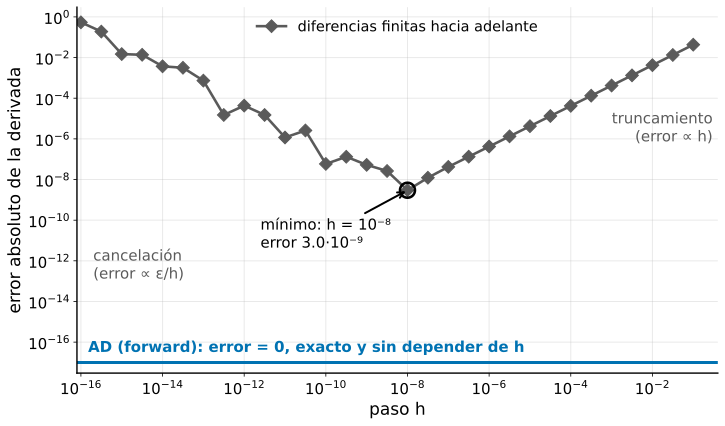
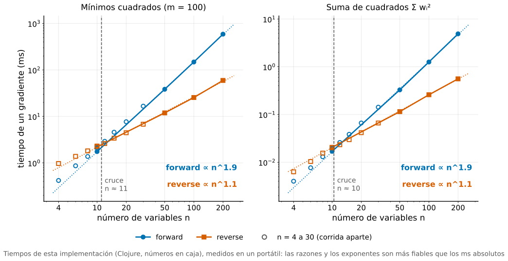

# Diferenciación automática

Notas de teoría del módulo `fpnum.ad`. Las cifras citadas salen de `docs/data/` (ver [`cifras.md`](cifras.md)) y las decisiones de diseño, con sus mediciones, están en [`decisiones.md`](decisiones.md).

## 1. Motivación

Muchos métodos numéricos (descenso de gradiente, mínimos cuadrados no lineales, redes neuronales) necesitan derivadas de funciones que se programan, no de fórmulas escritas en papel. Hay cuatro maneras de obtenerlas:

| Método | Resultado | Problema |
|---|---|---|
| A mano | exacto | tedioso y propenso a errores; hay que rehacerlo si cambia la función |
| Diferencias finitas | aproximado | el error depende de $h$ (sección 2) y cuesta $n$ evaluaciones por gradiente |
| Derivación simbólica | exacto | la expresión puede crecer enormemente («expression swell») y no maneja bien bucles ni condicionales |
| **Diferenciación automática (AD)** | **exacto hasta el redondeo** | hay que ejecutar la función con tipos especiales |

La AD no aproxima ni manipula fórmulas: **ejecuta el programa** propagando, junto con cada valor, información sobre su derivada. Como todo programa numérico es una composición de operaciones elementales cuyas derivadas se conocen, la regla de la cadena da la derivada del conjunto.

## 2. Diferencias finitas y su límite

La derivada hacia adelante aproxima $f'(x) \approx \dfrac{f(x+h) - f(x)}{h}$. Hay dos errores que compiten:

- **Truncamiento**: viene del desarrollo de Taylor, $f(x+h) = f(x) + hf'(x) + \tfrac{h^2}{2}f''(x) + \dots$, y es del orden de $h\,f''(x)/2$. Baja al achicar $h$.
- **Cancelación**: $f(x+h)$ y $f(x)$ son casi iguales y su resta pierde cifras significativas. El error absoluto de cada evaluación es del orden de $\varepsilon\,|f|$, y al dividir por $h$ queda del orden de $\varepsilon\,|f|/h$. Sube al achicar $h$.

La suma de ambos tiene forma de U (Figura 1) con mínimo cerca de $h \approx \sqrt{\varepsilon}$ (aquí $\varepsilon \approx 2.2\cdot10^{-16}$, o sea $h \approx 10^{-8}$). En la medición con $f = \sin$ en $x = 1$, el mejor error es de **3.0·10⁻⁹** en $h = 10^{-8}$; con $h = 0.1$ es de 4.3·10⁻² (domina el truncamiento) y con $h = 10^{-16}$ es de 0.54 (la cancelación lo destruye).



La AD no tiene parámetro $h$ ni resta de números próximos: en el mismo ejemplo su error es 0. Como mucho acumula errores de redondeo de la propia evaluación, del orden de $\varepsilon$.

## 3. Números duales y modo forward

Un **número dual** es $a + b\varepsilon$ con $\varepsilon^2 = 0$ y $\varepsilon \neq 0$. Guarda un valor ($a$) y una derivada ($b$). Se implementa en `fpnum.ad.forward` como un `defrecord Dual [a b]`.

**Por qué funciona.** Si se desarrolla $f$ en serie de Taylor alrededor de $a$ y se evalúa en $a + \varepsilon$, todos los términos con $\varepsilon^2$ o más se anulan:

$$f(a + \varepsilon) = f(a) + f'(a)\,\varepsilon.$$

Por tanto, evaluar $f$ sobre $a + 1\cdot\varepsilon$ devuelve en la parte dual la derivada en $a$.

**Reglas de las operaciones.** Se definen operando con $\varepsilon^2 = 0$:

- Suma: $(a + b\varepsilon) + (c + d\varepsilon) = (a + c) + (b + d)\varepsilon$.
- Producto: $(a + b\varepsilon)(c + d\varepsilon) = ac + (ad + bc)\varepsilon$, la regla del producto.
- Cociente: $\dfrac{a + b\varepsilon}{c + d\varepsilon} = \dfrac{a}{c} + \dfrac{bc - ad}{c^2}\varepsilon$, la regla del cociente.
- Funciones: $\sin(a + b\varepsilon) = \sin a + (\cos a\cdot b)\,\varepsilon$; en general $g(a + b\varepsilon) = g(a) + g'(a)\,b\,\varepsilon$.

**La regla de la cadena aparece sola.** Al componer $g(f(x))$, la derivada que sale de $f$ entra como $b$ de $g$ y se multiplica por $g'$: nadie programa la regla de la cadena, es consecuencia de que cada operación propague su parte dual.

**En Clojure.** El usuario escribe sus funciones con `d+`, `d*`, `dsin`... en lugar de las de `clojure.core`, que no saben operar con duales. Los números normales se aceptan mezclados con duales y se tratan como constantes (derivada 0). Las funciones no lanzan excepciones por dominio: `dlog` de un negativo da `NaN` y la división por cero da `±Infinity`, como los doubles.

```clojure
(diff (fn [x] (d+ (d* x x) (dsin x))) 1.0)   ; 2·1 + cos 1
```

## 4. Gradientes con forward

Cada pasada con una semilla $\varepsilon$ da **una** derivada parcial. Para el gradiente de $f:\mathbb{R}^n \to \mathbb{R}$ hacen falta $n$ pasadas, sembrando $\varepsilon$ en la variable $i$ y 0 en las demás. `fpnum.ad.forward/grad` lo hace así. El costo es $n$ veces el de evaluar $f$ y, cuando $f$ misma cuesta $O(n)$ (por ejemplo, una suma de cuadrados), el gradiente cuesta $O(n^2)$.

## 5. Modo reverse

Forward es eficiente cuando hay pocas entradas. Un gradiente de muchas entradas y **una** salida (la situación típica de optimización) se obtiene mejor al revés:

1. **Pasada hacia adelante.** Se evalúa $f$ sobre `Node`s. Cada operación calcula su valor y devuelve un nodo nuevo que guarda la operación y sus argumentos. El resultado es un grafo acíclico de cálculo.
2. **Pasada hacia atrás.** El **adjunto** de un nodo es $\bar v = \partial\,\text{salida}/\partial\,\text{nodo}$. El de la salida es 1. Cada nodo reparte su adjunto entre sus argumentos multiplicándolo por la derivada local de su operación (regla de la cadena).

**Por qué se suma.** Si un nodo se usa en varios sitios (por ejemplo $x$ en $x\cdot x + \sin x$), la salida depende de él por varios caminos, y la derivada total es la suma de las contribuciones de todos. Por eso el adjunto de un nodo es la **suma** de lo que recibe de todos los nodos que lo usan.

**Orden.** Un nodo solo puede repartir su adjunto cuando ya ha recibido todo, es decir, hay que procesar los nodos en orden topológico inverso (los que lo usan, antes que él). En este proyecto el orden sale gratis de los ids (sección 7): basta ir por id decreciente.

**Costo.** La pasada hacia atrás cuesta una pequeña constante por el costo de $f$ (en la documentación del módulo, unas 3 a 5 veces), **sin depender de $n$**, a cambio de guardar todo el grafo en memoria: la memoria es proporcional al número de operaciones evaluadas.

## 6. Forward frente a reverse

| | Forward | Reverse |
|---|---|---|
| Pasadas para un gradiente ($n$ entradas, 1 salida) | $n$ | 1 hacia adelante y 1 hacia atrás |
| Memoria | constante por valor | proporcional al número de operaciones |
| Conviene con | pocas entradas, muchas salidas | muchas entradas, pocas salidas |



En las mediciones (ver [`cifras.md`](cifras.md)) el costo de un gradiente crece con exponente **1.89–1.94** en forward y **1.05–1.11** en reverse, es decir, aproximadamente $n^2$ y $n$. La razón de tiempos forward/reverse con $n = 200$ llega a unas 9–12 veces.

**Por qué reverse pierde con pocas variables.** Construir el grafo y recorrerlo tiene una constante mayor que propagar un dual. Las dos curvas se cruzan en $n \approx 10$–$11$ (11.1 en mínimos cuadrados y 10.4 en la suma de cuadrados): por debajo, forward es más rápido. Ese punto depende de la implementación (con números en caja de Clojure) y de la máquina; no es una propiedad del método.

## 7. Diseño funcional

**Una función, dos modos.** Las operaciones (`d+`, `d*`, `dsin`...) son genéricas: con duales y números siguen el camino directo, y con un valor que implemente el protocolo `fpnum.ad.protocol/ADValue` (los nodos de reverse) delegan en él. Así la misma función de usuario sirve con `fpnum.ad.forward/grad` y con `fpnum.ad.reverse/grad`, y `gradient-descent` acepta cualquiera con la opción `:grad-fn`. En forward la comprobación de tipo se hace contra clases concretas, porque contra una interfaz resultó más lenta (D3).

**Datos inmutables y funciones puras.** Duales y nodos son valores: las operaciones devuelven valores nuevos y no modifican nada. La pasada hacia atrás es una función pura que recibe el grafo y devuelve los adjuntos.

**El problema de la identidad de los nodos (D1).** Para sumar adjuntos hay que saber cuándo dos referencias son el mismo nodo. Se probó primero una identidad **estructural** (el id de un nodo es la tupla `[op id-arg ...]`), que sería pura y fusionaría subexpresiones iguales. Midiendo, resultó inviable: la igualdad de vectores anidados es recursiva, una suma de unos 5 000 términos desbordaba la pila y construir dos veces una expresión muy compartida costaba 4 veces más por cada +2 de profundidad (exponencial). Se cambió a un **contador global** (un `atom`) que numera los nodos: la igualdad pasa a ser la de un entero, cadenas de 100 000 términos funcionan y el costo es lineal.

**Lo que se gana y lo que se pierde.** Se pierde la pureza estricta, porque el contador es estado global, aunque benigno: los ids solo distinguen nodos y el gradiente no depende de qué números se asignen. Además, dos subexpresiones iguales construidas por separado son nodos distintos: es más trabajo repetido, nunca un resultado distinto.

**Orden por ids (D4).** Como un nodo se crea siempre después que sus argumentos, su id es mayor que el de ellos, y procesar por id decreciente es un orden topológico inverso válido. Eso permite sustituir el recorrido en profundidad por un `sorted-map` por id, con menos código, y fue de 2 a 3 veces más rápido en las mediciones. Por qué es más rápido queda como **hipótesis no verificada**.

**Heurística (D2).** Un `Dual` con derivada exactamente 0 se trata como una constante cuando se mezcla con un nodo. Es una heurística y puede aceptar en silencio una mezcla de modos que no debería.

## 8. La macro `ad-fn`

`fpnum.ad.syntax/ad-fn` permite escribir las funciones como matemática normal y las reescribe:

```clojure
(ad-fn [[x y]] (+ (* x x y) (Math/sin y)))
;; equivale a
(fn [[x y]] (d+ (d* x x y) (dsin y)))
```

Es un buen ejemplo de **código como datos**: en Clojure el cuerpo de la función es una estructura de listas y símbolos que la macro recorre y transforma antes de compilarla. Pasos: expandir todas las macros del cuerpo con `macroexpand-all` y sustituir los símbolos de una tabla (`+ - * /`, `Math/sin`...).

**Límites aceptados** (detalle en el docstring del namespace): solo reescribe lo que ve en su cuerpo, no las funciones definidas fuera; no maneja el sombreado de nombres (un local llamado `+` hace que no compile); no reescribe comparaciones, `min`, `max` ni `abs`; y una función creada con ella devuelve un `Dual`, no un número, si se la llama con números normales. Un segundo incremento que manejara el sombreado se **descartó** a propósito (D5): el fallo es ruidoso (no compila) y el caso es raro.

## 9. Limitaciones y extensiones

- No hay **derivadas de orden superior ni Hessianos**: la AD anidada (forward sobre reverse) no está soportada.
- Los **condicionales** sobre valores diferenciables y funciones como `min` o `abs` no están cubiertos: la derivada es la de la rama que se ejecuta, y en los puntos de no diferenciabilidad la AD no avisa.
- Reverse guarda todo el grafo: para programas muy largos habría que recomputar parte de la pasada hacia adelante (*checkpointing*), que no se implementa.
- Con números en caja, el rendimiento no compite con bibliotecas como JAX o PyTorch: es una implementación pedagógica.

## 10. Para ampliar

- Baydin, Pearlmutter, Radul y Siskind. «Automatic Differentiation in Machine Learning: a Survey». *JMLR*, 2018.
- Elliott. «The Simple Essence of Automatic Differentiation», 2018.
- Griewank y Walther. *Evaluating Derivatives*. SIAM.
