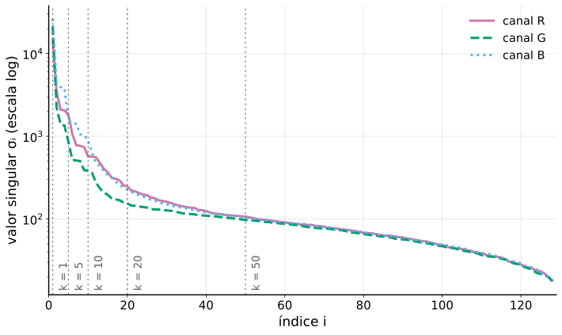
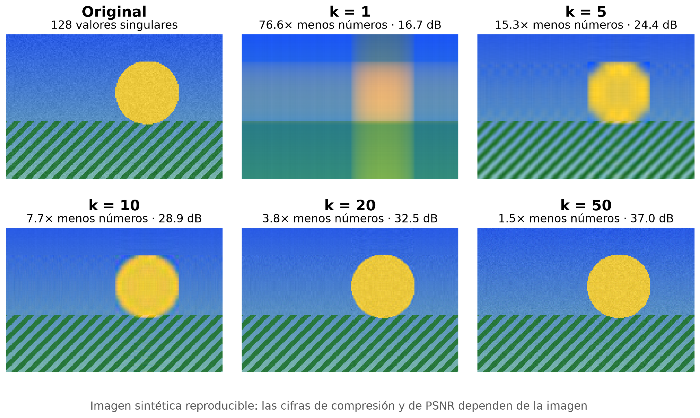
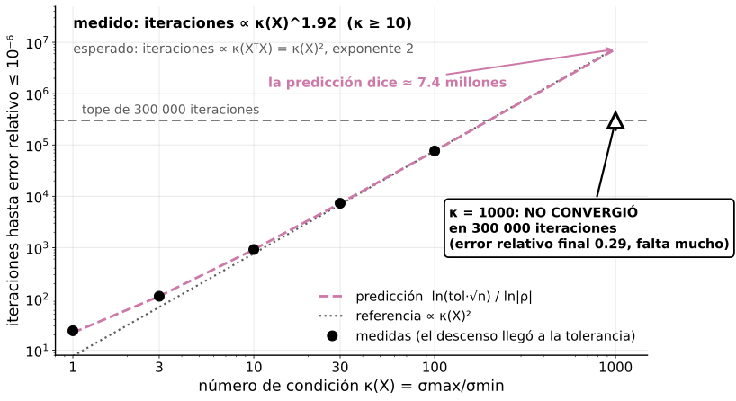

# SVD, compresión de imágenes y mínimos cuadrados

Notas de teoría de `fpnum.svd.core`, `fpnum.svd.image` y `fpnum.optim`. Las cifras salen de `docs/data/` (ver [`cifras.md`](cifras.md)). Las cifras de compresión son de la **imagen sintética** reproducible del repositorio; con otra imagen cambian.

## 1. Qué es la SVD

Toda matriz $A$ de $m \times n$ se descompone como

$$A = U\,\Sigma\,V^\top,$$

con $U$ y $V$ de columnas ortonormales y $\Sigma$ diagonal con los **valores singulares** $\sigma_1 \ge \sigma_2 \ge \dots \ge 0$. Aquí se usa la **forma económica**: con $k = \min(m, n)$, $U$ es $m \times k$, $V$ es $n \times k$ y hay $k$ valores singulares.

**Interpretación geométrica.** $A$ actúa como una rotación ($V^\top$), un estiramiento a lo largo de los ejes ($\Sigma$) y otra rotación ($U$). Los $\sigma_i$ son los factores de estiramiento: la imagen de la esfera unidad es un elipsoide de semiejes $\sigma_i u_i$. De ahí que $\sigma_{\max}$ sea la norma 2 de $A$ y que $\sigma_{\min}$ mida la dirección que $A$ menos amplifica.

**Forma como suma.** $A = \sum_{i} \sigma_i\,u_i v_i^\top$: una suma de matrices de rango 1 ordenadas por importancia, lo que habilita la aproximación de bajo rango (sección 4).

## 2. El método de Jacobi de un solo lado

La idea (Hestenes): buscar una matriz ortogonal $V$ tal que las columnas de $B = AV$ sean **ortogonales entre sí**. Entonces

$$B = U\Sigma \quad\text{con}\quad \sigma_j = \lVert b_j\rVert,\ u_j = b_j/\sigma_j \quad\Rightarrow\quad A = U\Sigma V^\top.$$

**La rotación de un par de columnas.** Para dos columnas $a_p, a_q$ se calculan $\alpha = a_p\cdot a_p$, $\beta = a_q\cdot a_q$, $\gamma = a_p\cdot a_q$ y

$$\zeta = \frac{\beta - \alpha}{2\gamma},\qquad t = \frac{\operatorname{sgn}\zeta}{|\zeta| + \sqrt{1 + \zeta^2}},\qquad c = \frac{1}{\sqrt{1 + t^2}},\qquad s = c\,t,$$

y se reemplazan $a_p' = c\,a_p - s\,a_q$, $a_q' = s\,a_p + c\,a_q$. El valor $t$ es la raíz de menor módulo de $t^2 + 2\zeta t - 1 = 0$, y con él $a_p'\cdot a_q' = 0$: las dos columnas quedan ortogonales. Se elige la raíz pequeña para que el ángulo de giro sea de $45°$ como máximo, lo que es numéricamente estable. Las mismas rotaciones se aplican a $V$, que parte de la identidad.

**Barridos y parada.** Un **barrido** recorre todos los pares $(p, q)$ y rota los que no son ortogonales (según una medida relativa $|\gamma|/\sqrt{\alpha\beta}$). Rotar un par puede desordenar otros, pero el conjunto converge. Se detiene cuando ninguna pareja supera la tolerancia, que por defecto es $2\max(m,n)\,\varepsilon$ (más estricta no tiene sentido: es el nivel de ruido de redondeo), o al llegar a 60 barridos. En las matrices de prueba bastan **de 1 a 13 barridos** (10, 13 y 13 en las de tamaño 64, 128 y 256). La convergencia final es cuadrática.

**Al terminar.** $\sigma_j$ es la norma de la columna $j$ de $B$, $u_j = b_j/\sigma_j$, y $V$ es la matriz acumulada de rotaciones. Se ordenan por $\sigma$ decreciente.

**Casos especiales** (`fpnum.svd.core`):
- Si $m < n$ se calcula la SVD de $A^\top$ y se intercambian $U$ y $V$.
- Antes de iterar se multiplica $A$ por una potencia de 2 (operación exacta) que deja su mayor entrada en $[1, 2)$, y se reescalan los $\sigma$ al final. Sin eso, entradas del orden de $10^{-76}$ hacen que $\alpha\beta$ se desborde por abajo a 0, y muy grandes lo hacen por arriba.
- Una columna numéricamente nula ($\sigma_j \le 4\max(m,n)\,\varepsilon\,\lVert A\rVert_F$) no tiene $u_j$ determinado. No se rota, y su $u_j$ se completa con un vector ortonormal a los demás, para que $U$ conserve columnas ortonormales. En matrices de rango deficiente los vectores singulares de esos $\sigma$ tan pequeños no están determinados.

## 3. Por qué no se forma $A^\top A$

Los $\sigma_i$ de $A$ son las raíces de los autovalores de $A^\top A$, así que podría obtenerse la SVD diagonalizando esa matriz. Pero formar $A^\top A$ eleva al cuadrado el número de condición: $\kappa(A^\top A) = \kappa(A)^2$. Con $\kappa(A) = 10^{10}$ serían $10^{20}$, más allá de lo que distingue un `double` ($\varepsilon \approx 10^{-16}$), y los valores singulares pequeños se pierden. Jacobi rota las columnas de $A$ directamente y conserva buena precisión relativa en los $\sigma$ pequeños.

La medición lo confirma (error relativo del $\sigma$ mínimo; `data/svd-ata-vs-directo.csv`):

| Matriz | $\kappa$ | Jacobi directo | Vía $A^\top A$ |
|---|---:|---:|---:|
| aleatoria 10×10 | 9.9·10¹ | 7.5·10⁻¹⁶ | 1.6·10⁻¹³ |
| Hilbert 8 | 1.5·10¹⁰ | 1.3·10⁻⁷ | **1.3·10²** |
| Hilbert 10 | 1.6·10¹³ | 8.0·10⁻⁵ | **4.3·10⁵** |

Un error relativo de $10^2$ o más significa que el valor calculado es basura. El método directo pierde precisión con $\kappa$ (la matriz ya viene redondeada), pero de forma gradual.

## 4. Eckart–Young–Mirsky

**Teorema.** Entre todas las matrices de rango $\le k$, la mejor aproximación a $A$ es

$$A_k = \sum_{i=1}^{k} \sigma_i u_i v_i^\top,$$

tanto en norma 2 como en norma de Frobenius, con errores

$$\lVert A - A_k\rVert_2 = \sigma_{k+1},\qquad \lVert A - A_k\rVert_F^2 = \sum_{i>k}\sigma_i^2.$$

**Por qué esas fórmulas.** $A - A_k = \sum_{i>k}\sigma_i u_i v_i^\top$ tiene como valores singulares $\sigma_{k+1}, \sigma_{k+2}, \dots$; su norma 2 es el mayor, $\sigma_{k+1}$, y la de Frobenius es la raíz de la suma de cuadrados. Que ninguna otra matriz de rango $k$ lo haga mejor es el contenido del teorema (se demuestra con el principio minimax de Courant–Fischer).

En el proyecto, `svd/truncate` conserva las $k$ primeras columnas de $U$ y $V$ y los $k$ primeros $\sigma$. Las pruebas de `image_test.clj` comprueban las dos igualdades en matrices aleatorias.

## 5. Compresión de imágenes

**Procedimiento.** Cada canal (R, G, B) es una matriz $A$ de $128 \times 192$. Se calcula su SVD, se conservan los $k$ valores singulares mayores y se reconstruye $A_k$.

**Por qué decaen los $\sigma$** (Figura 2). Los píxeles vecinos se parecen, así que filas y columnas de la imagen son casi combinaciones unas de otras: la matriz es casi de rango bajo. Un par de componentes capturan el brillo medio y las estructuras grandes, y los detalles finos y el ruido quedan en $\sigma$ pequeños. En la imagen sintética los valores singulares caen dos órdenes de magnitud en los primeros ~20 índices.

**Energía retenida.** $\sum_{i\le k}\sigma_i^2 / \sum_i\sigma_i^2$. La matriz no se centra, por eso con $k = 1$ ya se retiene el **92.98 %**: el primer término captura el brillo medio. Con $k = 20$ es el **99.82 %**.

**Almacenamiento.** $A_k$ necesita $k(m + n + 1)$ números ($k$ columnas de $U$, de $V$ y los $\sigma$), frente a $mn$. La razón de compresión es $mn/\big(k(m+n+1)\big)$: 76.6× con $k = 1$, 15.3× con $k = 5$, 3.8× con $k = 20$, 1.5× con $k = 50$ y 0.6× con el rango completo ($k = 128$): a partir de $k \approx 75$ la SVD ocupa más que la imagen.

**PSNR.** $10\log_{10}(255^2/\text{MSE})$ en dB, calculado sobre la imagen ya redondeada a 8 bits, que es lo que se mostraría. Vale 16.7 dB con $k = 1$, 24.4 con $k = 5$, 32.5 con $k = 20$ y 37.0 con $k = 50$. Si la imagen es idéntica el MSE es 0 y el PSNR es infinito.

**Artefactos** (Figura 3). Con $k$ pequeño la imagen se descompone en bandas horizontales y verticales (un producto de rango 1 es la suma de «una columna por una fila»), los bordes se emborronan y las texturas desaparecen primero. Con $k = 5$ ya se reconoce la escena y con $k = 20$ casi no se distingue de la original.

**Frente a JPEG.** No compite: JPEG usa la DCT por bloques, cuantiza y codifica, y logra razones de compresión mucho mayores con calidad visual. La SVD es un ejemplo pedagógico de aproximación de bajo rango, y aquí además $U$ y $V$ se guardan en `double`.

**Qué depende de la imagen.** Todas las cifras de esta sección: una fotografía tiene otra distribución de valores singulares. Lo general es la teoría (EYM y la fórmula de almacenamiento).

## 6. Pseudoinversa y mínimos cuadrados

**Pseudoinversa.** $X^{+} = V\,\Sigma^{+}\,U^\top$, donde $\Sigma^{+}$ invierte los $\sigma_i$ no nulos y deja en cero los demás. Cumple las cuatro condiciones de Moore–Penrose:
$X X^{+} X = X$, $X^{+} X X^{+} = X^{+}$, $(X X^{+})^\top = X X^{+}$ y $(X^{+}X)^\top = X^{+}X$.

**Mínimos cuadrados.** La solución de $\min_w \lVert Xw - y\rVert^2$ es $w = X^{+}y = \sum_i \dfrac{u_i^\top y}{\sigma_i}\,v_i$, que se calcula sin formar $X^{+}$ explícitamente (`least-squares-svd`). Si $X$ tiene rango deficiente, hay infinitas soluciones y $X^{+}y$ es la de **mínima norma**.

**Tolerancia como regularización.** Se invierten solo los $\sigma_i$ por encima de $\text{rcond}\cdot\sigma_{\max}$ (por defecto $\max(m,n)\,\varepsilon$). Descartar los pequeños evita amplificar el ruido en las direcciones que $X$ casi no ve: $1/\sigma_i$ sería enorme.

**Frente a las ecuaciones normales.** $X^\top X\,w = X^\top y$ eleva al cuadrado el número de condición, y `solve` las rechaza cuando $X^\top X$ es singular. Medido en `data/conditioning-accuracy.csv`:

| $\kappa(X)$ | Error con SVD | Error con ecuaciones normales |
|---:|---:|---:|
| 10⁴ | 5.7·10⁻¹³ | 1.5·10⁻⁹ |
| 10⁶ | 8.3·10⁻¹¹ | 2.7·10⁻⁵ |
| 10⁷ | 1.5·10⁻⁹ | singular |
| 10¹² | 5.3·10⁻³ | singular |

El error con SVD es del orden de $\kappa\varepsilon$, y con ecuaciones normales del orden de $\kappa^2\varepsilon$.

## 7. Número de condición y descenso de gradiente

**Número de condición.** $\kappa(X) = \sigma_{\max}/\sigma_{\min}$ mide cuánto amplifica $X$ los errores relativos: resolver con datos perturbados en $\epsilon$ da una solución perturbada en torno a $\kappa\,\epsilon$. Con $\kappa \approx 10^{16}$ la matriz es numéricamente singular en doble precisión.

**Descenso en mínimos cuadrados.** Con $f(w) = \lVert Xw - y\rVert^2$, el gradiente es $2X^\top(Xw - y)$ y el paso es $w \leftarrow w - \alpha\nabla f$. Con el paso seguro $\alpha = 0.9/\lVert X\rVert_F^2$ el error en la dirección singular $i$ se multiplica por $1 - 2\alpha\sigma_i^2$ en cada iteración. El factor más lento es el de $\sigma_{\min}$:

$$\rho = 1 - 2\alpha\sigma_{\min}^2 \approx 1 - \frac{1.8}{\kappa(X)^2}.$$

**Iteraciones $\propto \kappa(X)^2$** (Figura 5). Para reducir el error en un factor fijo hacen falta $\ln(\text{tol})/\ln\rho \approx \kappa^2$ iteraciones: es el número de condición de la Hessiana $\kappa(X^\top X) = \kappa(X)^2$ el que manda. El exponente medido en $\kappa \ge 10$ es **1.92** (cercano al 2 esperado), y las iteraciones medidas coinciden con la predicción teórica: 113, 921, 7 312 y 76 444 para $\kappa = 3, 10, 30, 100$. Con $\kappa = 1000$ la teoría pide unos 7.4 millones, y con tope de 300 000 iteraciones el descenso **no converge** (error relativo final 0.29).

**Parar por el gradiente engaña.** El gradiente es $\nabla f = 2X^\top X(w - w^\ast)$, así que en la dirección lenta vale $2\sigma_{\min}^2$ por el error. Con $\kappa = 100$, el criterio $\lVert\nabla f\rVert \le 10^{-8}$ se cumple con un error real de 5.0·10⁻⁵, mucho mayor que la tolerancia buscada.

**Rango deficiente.** Con una columna duplicada las ecuaciones normales fallan; la SVD da la solución de mínima norma (rango numérico 3 en el ejemplo, con 4 columnas), y el descenso desde $w = 0$ converge a la misma (81 iteraciones, a 2.8·10⁻¹⁴). El gradiente $2X^\top(\cdot)$ siempre está en el espacio fila de $X$, así que las iteraciones nunca salen de ese espacio, que es donde vive la solución de mínima norma.

## 8. La implementación

Hay dos versiones con la misma API y los mismos barridos (`fpnum.svd.core`):
- `svd-reference`: estructuras inmutables (vectores de vectores) y funciones puras. Es la más fácil de leer y de verificar, pero lenta.
- `svd`: hace exactamente las mismas operaciones en el mismo orden, pero sobre arrays `double[]` privados que nacen y mueren dentro de la llamada, así que de cara al exterior sigue siendo pura. Las pruebas diferenciales exigen que ambas coincidan.

**Norma en caché.** Cada par necesita $\alpha$ y $\beta$, y un barrido tiene $n(n-1)/2$ pares. Recalcularlas costaría tres productos escalares por par; con las normas² guardadas y actualizadas en el mismo bucle que escribe las columnas rotadas, cuesta un producto escalar ($\gamma$) y una pasada. La caché se suma en el mismo orden que el cálculo directo, por lo que su valor es idéntico y no hay deriva numérica (a diferencia de $\alpha' = \alpha - t\gamma$, que sufre cancelación). Las dos versiones dan resultados idénticos bit a bit en las matrices de prueba.

**Velocidad.** La razón de tiempos referencia/rápida fue de 15×, 66× y 112× para $n = 64, 128, 256$ en una corrida; en otras corridas con $n = 256$ salieron entre 50 y 110. Se puede decir «dos órdenes de magnitud», no una cifra exacta.

## 9. Precisión numérica

**Frente a NumPy.** En 12 matrices de prueba (cuadradas, altas, anchas, de rango deficiente y de Hilbert), la diferencia máxima de $\sigma$ es 7.8·10⁻¹⁶·$\sigma_1$, el error relativo de reconstrucción es $\le$ 1.7·10⁻¹⁵ y la ortonormalidad de $U$ y $V$, $\le$ 5.3·10⁻¹⁵.

**Rango numérico.** En aritmética de punto flotante el rango exacto no se puede decidir: lo que se mide es cuántas direcciones se distinguen del ruido de redondeo (los $\sigma$ por encima de $\text{rcond}\cdot\sigma_{\max}$).

**Hilbert.** Sus $\sigma$ más pequeños están limitados por la representación en `double` de la propia matriz, no por el algoritmo. Como comprobación independiente de NumPy, el producto de los $\sigma$ coincide con el determinante exacto de Hilbert (calculado con racionales) con error relativo 4.5·10⁻¹², 1.0·10⁻⁷ y 2.5·10⁻⁵ para $n = 5, 8, 10$: el error crece con $\kappa$.

## 10. Para ampliar

- Trefethen y Bau. *Numerical Linear Algebra*. SIAM.
- Strang. *Introduction to Linear Algebra*.
